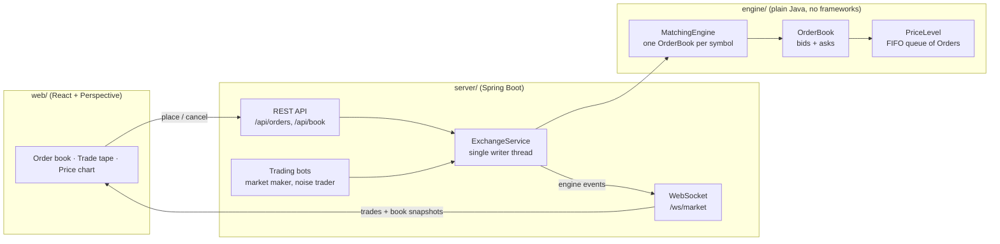

# Clyde Exchange

A stock exchange simulator written in Java 21. At its core is a **price-time priority matching engine**: the same basic mechanism real exchanges use to decide who trades with whom, at what price, and in what order.

> **Status: work in progress.** The order model and price levels are built and tested. The order book, REST API, live market data, trading bots and dashboard are designed but not built yet. See [Status](#status).

---

## Architecture



### Why it's split this way

- **The `engine` module has no dependencies at all**, apart from JUnit for tests, and Maven enforces this. The matching logic is pure Java. Given the same inputs, it always produces the same outputs. That makes it easy to test, and it can later be benchmarked or placed behind a message queue without changing it.
- **Single writer.** Only one thread ever touches the order book. REST requests and bots hand their orders to `ExchangeService`, which processes them one at a time. This avoids locks and race conditions completely. The approach is a small version of the "single writer principle" used in the LMAX exchange architecture.

---

## Matching rules

- **Price-time priority.** The best price trades first. At the same price, whichever order arrived first trades first (FIFO).
- **Limit orders** trade while they *cross* the book: a buy matches when its price ≥ the best ask, and a sell matches when its price ≤ the best bid. Whatever is left rests on the book.
- **Trades execute at the resting order's price.** The order that was already waiting sets the price.
- **Market orders** sweep the opposite side until filled. Any leftover is cancelled, never rested. A market order into an empty book is rejected.
- **Validation:** quantity must be > 0. A fill can never exceed an order's remaining quantity.

## Data structures

| What | Choice | Why |
|---|---|---|
| Prices | `long` in ticks (£101.25 → `10125`) | `double` can't represent values like 0.1 exactly, so equality checks on prices would break. Real exchanges use integer ticks. |
| Orders at one price | `ArrayDeque<Order>` inside `PriceLevel` | Gives FIFO order for free, so arrival order *is* the time priority. |
| Total quantity at a price | cached `totalQty` field | Quantity at a price can be read instantly, in O(1). Every fill goes through `PriceLevel`, so the cached total can't drift out of date. |
| Price levels | `TreeMap<Long, PriceLevel>`; bids use `Comparator.reverseOrder()` | Kept sorted, so the best price is always the first entry, in O(log n). |
| Cancel lookup | `HashMap<orderId, Order>` | O(1) lookup by id. |

**Alternatives considered**
- `PriorityQueue<Order>`: no grouping by price level, cancels are O(n), and ties need a separate comparator.
- An array indexed by price tick: O(1) for everything, and the approach high-frequency engines use, but it needs a fixed price range.

---

## Running it

You need JDK 21. Maven is not required, because the project includes the Maven Wrapper.

```bash
./mvnw test                 # run all tests (Windows: .\mvnw test)
./mvnw -pl engine test      # engine tests only
./mvnw -pl server spring-boot:run   # start the server on :8080
```

## Project layout

```
engine/   matching engine (plain Java)
  model/    Order, Side, OrderType
  book/     PriceLevel (OrderBook next)
server/   Spring Boot application
```

---

## Status

| Part | State |
|---|---|
| `Order`: fill logic with overfill/negative guards | ✅ done, tested |
| `PriceLevel`: FIFO queue + cached total | ✅ done, tested |
| `OrderBook`: bids/asks, limit-order matching | 🚧 in progress |
| Market orders, cancels, `MatchingEngine` | ⏳ planned |
| REST API + single-writer service | ⏳ planned |
| WebSocket market data + trading bots | ⏳ planned |
| Perspective dashboard | ⏳ planned |

## Known limitations

- No self-trade prevention: one participant can trade with themselves.
- No persistence. The book lives in memory and is lost on restart.
- Cancelling an order is O(k) in the number of orders at its price level.

## Roadmap

- **Kafka:** turn orders and engine events into topics. The engine is deterministic, so replaying the order log rebuilds the exact same book.
- **JMH benchmarks:** measure matching throughput and latency, and compare `ArrayDeque` against a linked list for fast cancels.
- **LMAX Disruptor:** replace the single-writer queue with a ring buffer, and measure the difference.
