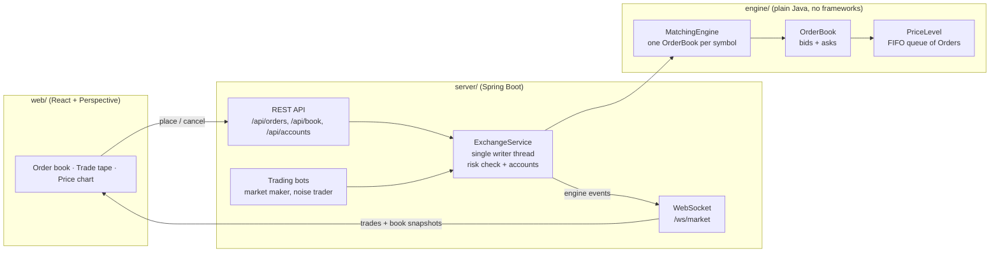

# Clyde Exchange

[](https://github.com/MannanHanda/clyde-exchange/actions/workflows/ci.yml)

A stock exchange simulator written in Java 21. At its core is a **price-time priority matching engine**: the same basic mechanism real exchanges use to decide who trades with whom, at what price, and in what order.

Bots trade against each other around the clock, and a live dashboard built with [Perspective](https://perspective.finos.org/) (the streaming analytics library open-sourced by J.P. Morgan) shows the order book, price chart and trade tape. You get a paper-trading account with £100,000 of pretend money and can trade against the bots from the browser, with your cash, positions and profit tracked live.


---

## Architecture



### Why it's split this way

- **The `engine` module has no dependencies at all**, apart from JUnit for tests. Only the `server` module depends on Spring. The matching logic is pure Java. Given the same inputs, it always produces the same outputs. That makes it easy to test, and it can later be benchmarked or placed behind a message queue without changing it.
- **Single writer.** Only one thread ever touches the order book. REST requests and bots hand their orders to `ExchangeService`, which processes them one at a time. This avoids locks and race conditions completely. The approach is a small version of the "single writer principle" used in the LMAX exchange architecture.

---

## Matching rules

- **Price-time priority.** The best price trades first. At the same price, whichever order arrived first trades first (FIFO).
- **Limit orders** trade while they *cross* the book: a buy matches when its price ≥ the best ask, and a sell matches when its price ≤ the best bid. Whatever is left rests on the book.
- **Trades execute at the resting order's price.** The order that was already waiting sets the price.
- **Market orders** sweep the opposite side until filled. Any leftover is cancelled, never rested. A market order into an empty book fills nothing and leaves no trace.
- **Self-trade prevention.** Every order belongs to an account, and an account can never trade with itself. If an incoming order reaches one of its own resting orders, it stops there and its remainder is cancelled (the "cancel newest" policy).
- **Validation:** quantity must be > 0. A fill can never exceed an order's remaining quantity.

## Data structures

| What | Choice | Why |
|---|---|---|
| Prices | `long` in ticks (£101.25 → `10125`) | `double` can't represent values like 0.1 exactly, so equality checks on prices would break. Real exchanges use integer ticks. |
| Orders at one price | `ArrayDeque<Order>` inside `PriceLevel` | Gives FIFO order for free, so arrival order *is* the time priority. |
| Total quantity at a price | cached `totalQty` field | Quantity at a price can be read instantly, in O(1). Every fill goes through `PriceLevel`, so the cached total can't drift out of date. |
| Price levels | `TreeMap<Long, PriceLevel>`; bids use `Comparator.reverseOrder()` | Kept sorted, so the best price is always the first entry, in O(log n). |
| Cancel lookup | `HashMap<orderId, Order>` | O(1) lookup by id. |

**Alternatives considered**
- `PriorityQueue<Order>`: no grouping by price level, cancels are O(n), and ties need a separate comparator.
- An array indexed by price tick: O(1) for everything, and the approach high-frequency engines use, but it needs a fixed price range.

## Accounts and paper trading

Every order carries an `accountId`, and every trade moves cash from the buyer to the seller and shares the other way.

- **Pre-trade risk check.** Before an order reaches the engine, the server checks the account can cover it in the worst case. There is no borrowing: you can't buy with money you don't have or sell shares you don't hold. A market buy is checked against what it would really cost by walking the ask side of the book.
- **Reserved funds.** Cash promised to resting buy orders, and shares promised to resting sell orders, can't be used twice. `buyingPower = cash - reservedCash`. Reservations are not stored: they are worked out from the engine's open orders each time, so they can't drift out of step with the book.
- **Why the check is safe.** The check and the match run back to back on the single writer thread, so nothing can change between "can they afford it?" and "do it". No locks needed.
- **Profit and loss.** Positions use the average-cost method. Selling realises profit against the average price paid; what you still hold is valued at the last trade price (unrealised).
- **Bots have accounts too** (`bot-maker`, `bot-noise-1`…). They skip the risk check, so they can go short, but their positions and profit are tracked the same way.
- **Trader accounts** are listed in `application.yml` under `exchange.accounts.starting-cash`. There is no login yet; the dashboard trades as `mannan`.

---

## Running it

You need JDK 21 and Node 22+. Maven is not required, because the project includes the Maven Wrapper.

```bash
./mvnw test                 # run all tests (Windows: .\mvnw test)
./mvnw -pl engine test      # engine tests only

./mvnw install -DskipTests && ./mvnw -pl server spring-boot:run   # 1. exchange + bots on :8080

cd web && npm install && npm run dev                              # 2. dashboard on http://localhost:5173
```

## REST API

All prices are in **ticks of 1p** (`10100` = £101.00). Symbols are configured in `server/src/main/resources/application.yml`.

| Method | Path | What it does |
|---|---|---|
| `POST` | `/api/orders` | Place an order. Body: `{"accountId","symbol","side","type","price","qty"}`; `price` can be left out for `MARKET`. Returns the order id, any trades, and `restingQty` (how much is now waiting on the book). |
| `DELETE` | `/api/orders/{symbol}/{id}?accountId=…` | Cancel one of your resting orders: `204`, or `404` if unknown, already filled, or not yours |
| `GET` | `/api/accounts/{id}` | Cash, buying power, positions, profit/loss, open orders and recent fills |
| `GET` | `/api/book/{symbol}?depth=10` | Top price levels on each side, best first |
| `GET` | `/api/trades/{symbol}?limit=50` | Recent trades, newest first |
| `GET` | `/api/symbols` | Tradable symbols |

Invalid or unaffordable orders get `400 Bad Request` with a message, e.g. `{"detail":"Quantity must be > 0, was 0"}` or `{"detail":"Insufficient shares: trying to sell 80 MANN but only 60 available"}`.

```bash
# buy 100 MANN from the bots at the best available prices, then offer 40 of them for sale at £105.00
curl -X POST localhost:8080/api/orders -H 'Content-Type: application/json' \
     -d '{"accountId":"mannan","symbol":"MANN","side":"BUY","type":"MARKET","qty":100}'
curl -X POST localhost:8080/api/orders -H 'Content-Type: application/json' \
     -d '{"accountId":"mannan","symbol":"MANN","side":"SELL","type":"LIMIT","price":10500,"qty":40}'
curl localhost:8080/api/accounts/mannan   # cash down, 100 MANN held, 60 available, one open order
```

## Live market data and bots

When the server starts, bots trade `MANN` and `CLYD` on their own (turn them off with `exchange.sim.enabled: false`):

- **Fair value:** each symbol has a hidden "true" price that takes a small random step every 250 ms (a random walk).
- **Market maker:** always quotes 3 levels of bids just below fair value and asks just above it, and re-quotes every tick. This is the liquidity everyone else trades against.
- **Noise traders:** randomly send market orders (which create trades) and limit orders near fair value (which add depth). Their stale orders are cancelled.

Connect to `ws://localhost:8080/ws/market` to receive, at most every 200 ms:

```json
{"type":"trades","trades":[{"symbol":"MANN","buyOrderId":1751,"sellOrderId":1822,"price":9903,"qty":6,"timestamp":1793076835022}]}
{"type":"book","book":{"symbol":"MANN","bids":[{"price":9895,"qty":74}],"asks":[{"price":9903,"qty":180}]}}
```

**Why batched?** The matching thread never touches the network. It drops each trade into a lock-free queue, and a separate timer sends batches. A slow browser can't slow down matching, and the browser gets at most 5 updates a second instead of one per trade.

## Dashboard

`web/` is a small React app built with Vite. Perspective does the heavy lifting: it runs a columnar data engine in WebAssembly inside a Web Worker, so the browser can filter, sort and aggregate thousands of streaming rows without blocking the page.

- **One stream, many views.** `useMarketData` opens the WebSocket (reconnecting with exponential backoff) and writes into two in-browser Perspective tables: `trades` (capped at 20,000 rows) and `book` (indexed by `symbol:level`, so each snapshot overwrites rows in place). Every panel is a `<perspective-viewer>` over one of those tables with a different config. Switching symbol just changes a filter.
- **Order book:** best 10 levels each side, with in-cell bars showing size at each price.
- **Price chart:** the last trade price per second, using Perspective's `bucket()` expression and a `last` aggregate.
- **Trade tape:** newest first, with the aggressor side. The server doesn't send a side, but order ids only go up, so the newer of the buy and sell ids is the order that arrived and crossed the spread.
- **Order ticket:** sends real `MARKET` or `LIMIT` orders to `POST /api/orders` and reports what filled, what is waiting and what was cancelled.
- **Portfolio:** account value, cash, buying power and profit/loss, plus your positions, open orders (with a cancel button) and recent fills. It polls `GET /api/accounts/{id}` once a second.
- On page load it backfills the last 500 trades per symbol over REST, de-duplicating against the live stream.


## Project layout

```
engine/   matching engine (plain Java)
  model/    Order, Side, OrderType, Trade
  book/     PriceLevel, OrderBook, MatchingEngine, BookSnapshot, OpenOrder
server/   Spring Boot application
  service/  ExchangeService (single writer, risk check, settlement), TradeRecord
  account/  Account, Position (average cost, profit/loss), AccountView
  api/      OrderController, MarketDataController, AccountController, error handling
  ws/       MarketDataPublisher (batched WebSocket feed)
  sim/      FairValueModel, MarketMakerBot, NoiseTraderBot, SimulatorRunner
web/      React + Vite + Perspective dashboard
  src/perspective.js    starts Perspective (WebAssembly) and creates the tables
  src/useMarketData.js  WebSocket + REST backfill -> tables
  src/useAccount.js     polls the account
  src/Portfolio.jsx     cash, positions, open orders, fills
  src/App.jsx           layout and the viewer configs
```

---

## Status

| Part | State |
|---|---|
| `Order`: fill logic with overfill/negative guards | ✅ done, tested |
| `PriceLevel`: FIFO queue + cached total | ✅ done, tested |
| `OrderBook`: bids/asks, limit-order matching | ✅ done, tested |
| Market orders, cancels, `MatchingEngine` (validation, ids, one book per symbol) | ✅ done, tested |
| REST API + single-writer `ExchangeService` (incl. 8-thread concurrency test) | ✅ done, tested |
| WebSocket market data + trading bots (market maker, noise traders, random-walk fair value) | ✅ done, tested |
| Perspective dashboard: order book, price chart, trade tape, order ticket | ✅ done, verified in browser |
| Accounts: order ownership, cash and positions, buying-power check, self-trade prevention, profit/loss | ✅ done, tested |
| Portfolio panel: balances, positions, open orders with cancel, fills | ✅ done, verified in browser |

## Known limitations

- No login: the API trusts the `accountId` it is given.
- No persistence. The book and all account balances live in memory and are lost on restart.
- No short selling or margin for traders (the bots can go short).
- Cancelling an order is O(k) in the number of orders at its price level.

## Roadmap

- **Kafka:** turn orders and engine events into topics. The engine is deterministic, so replaying the order log rebuilds the exact same book.
- **JMH benchmarks:** measure matching throughput and latency, and compare `ArrayDeque` against a linked list for fast cancels.
- **LMAX Disruptor:** replace the single-writer queue with a ring buffer, and measure the difference.
